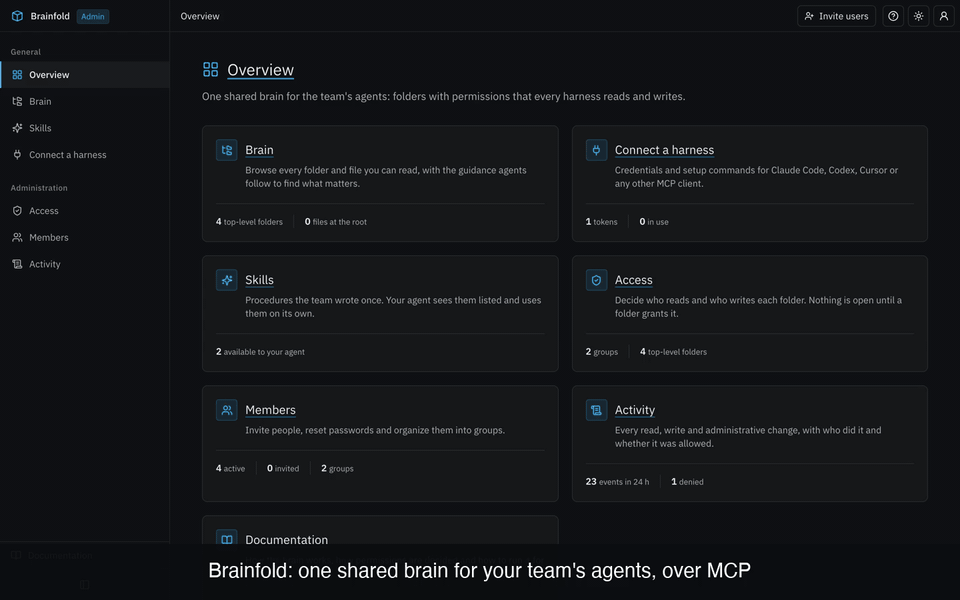
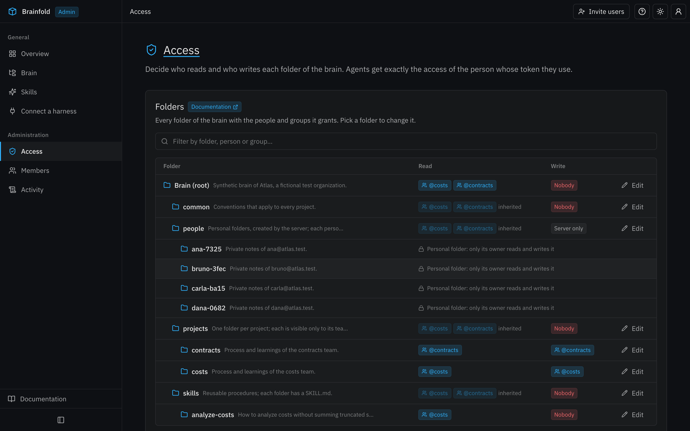
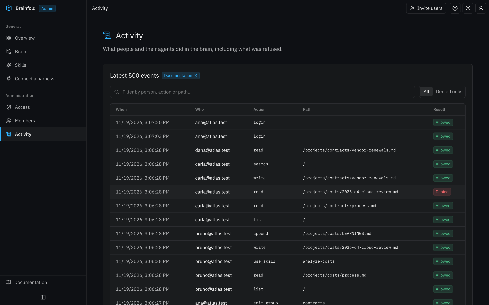

# Brainfold: a shared brain for agents

A personal, independent open source project, licensed under [Apache-2.0](LICENSE).

Brainfold is an MCP server that turns a folder into a team's shared brain: files with permissions that any harness (Claude Code, Codex or another) reads and writes. Full scope, including what it deliberately does not do, is in [docs/scope.md](docs/scope.md).



The same server answers each person's agent with that person's access. In the synthetic example, the costs folder does not exist for a member of the contracts team, and the refused read is in the activity log.

## Status

Development implementation. What works today: the MCP server over a folder on disk, read and write permissions per folder, file operations with conflict detection, files of any type through `brainfold put` and `brainfold get`, history and restore, folder guidance written by agents, personal folders, text search, skills delivered to each agent through `use_skill`, a learnings log, email and password accounts, personal tokens, groups, an activity log, and a web panel. By default the server listens on loopback only; a compose file runs it behind a TLS proxy for use across machines. Example data is synthetic. The plan in progress is [docs/designs/core-permissioned-memory.md](docs/designs/core-permissioned-memory.md).

## Try it

```bash
uv sync
cp -R examples/brain /tmp/brainfold-brain            # the server turns the brain folder into a git repository
uv run brainfold serve --root /tmp/brainfold-brain        # accounts and activity go to ./brainfold.db

# In another terminal: create the administrator, a group and a harness token.
J='Content-Type: application/json'; U=http://127.0.0.1:8020
curl -c cookies.txt -H "$J" -d '{"email":"you@example.com","password":"a-long-password"}' $U/api/setup
curl -b cookies.txt -X PUT -H "$J" -d '{"members":["you@example.com"]}' $U/api/groups/costs
curl -b cookies.txt -H "$J" -d '{"name":"claude code"}' $U/api/tokens   # shows the token once

claude mcp add --transport http brainfold $U/mcp --header "Authorization: Bearer <token>"
```

MCP tools: `list`, `read`, `write`, `edit`, `append`, `move`, `delete`, `create_folder`, `describe_folder`, `describe_file`, `search`, `history`, `restore`, `list_learnings`, `use_skill`.

Files of any type (a manual, a spreadsheet) go through the command line, which reads `BRAINFOLD_URL` and `BRAINFOLD_TOKEN` from the environment or from `~/.config/brainfold/config.toml` (mode 0600):

```bash
brainfold put salaries.xlsx /hr/salaries.xlsx
brainfold get /hr/salaries.xlsx ./salaries.xlsx
```

## Web panel

```bash
cd web && npm install && npm run build     # writes the panel into src/brainfold/panel
```

Start `brainfold serve` after the build (restart it if it was running; until then `/` answers 404) and it shows the panel at the server's address: an overview, the brain as a folder tree with search and rendered Markdown, the skills each person's agent receives, tokens with setup commands for each harness, an access table for every folder, members and groups, and activity. The product documentation is part of the panel, at `#/docs`, and needs no sign-in; its pages are Markdown files in `web/src/docs/`. While developing, `npm run dev` serves it with live reload and forwards `/api` to a server on port 8020. The container image builds the panel by itself.

| Access per folder | Activity, with refusals |
|---|---|
|  |  |

## Run it for a team

```bash
BRAINFOLD_DOMAIN=brain.example.com docker compose up -d
docker compose logs brainfold      # prints the setup code needed to create the first account
```

The server runs behind a proxy that terminates TLS and is never published directly. Creating the first account needs the printed setup code, sent as `"code"` in the `/api/setup` body. This was checked locally with the proxy's own certificate; it has not been run on a real domain yet.

## Brain format

Each folder may carry a `.brainfold.toml`:

```toml
description = "Process and learnings of the costs team."
start_here = ["process.md"]      # relative to the folder
read = ["@costs"]     # emails, @group or "*"
write = ["@costs"]
```

- **Read** is denied unless some folder on the path grants it; every folder that declares `read` narrows what hangs below it.
- **Write** is decided by the nearest folder that declares `write`; with no declaration it is denied.
- Groups and their members are managed in the accounts database through the API.
- An administrator sees the structure and access lists of every folder, but does not read content they were not granted.
- Files starting with a dot and symlinks are never visible to an agent.
- Every change is committed to a git repository in the brain root under the author's name. Replacing, moving or deleting a file needs the `version` returned by `read`, so two agents never overwrite each other silently.
- Each account gets a personal folder under `/people/` that only its owner can read or write.
- A skill is a folder with a `SKILL.md`. See `examples/brain/`.

## Verify

```bash
uv run pytest -q
uv run ruff check src tests
```

## Documentation

- [Scope](docs/scope.md)
- [Decision log](docs/decisions/README.md)
- [Prior art](docs/prior-art.md)
- [Core plan](docs/designs/core-permissioned-memory.md) and [TODOS](TODOS.md)
- [How to collaborate](AGENTS.md)
