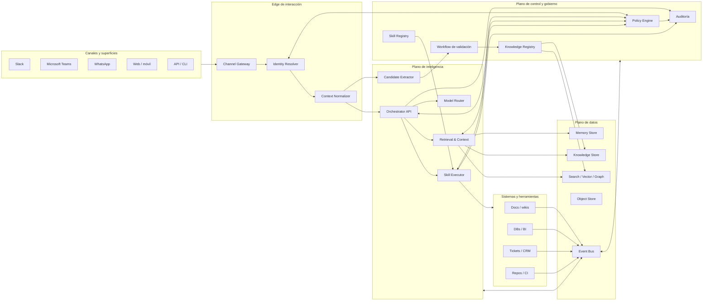
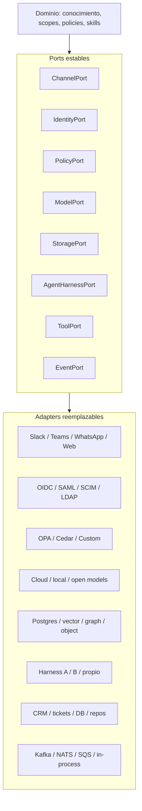

# Framework abierto de inteligencia organizacional colaborativa

> Documento de visión, producto y arquitectura de referencia  
> Estado: propuesta inicial para discusión y diseño  
> Nombre de trabajo: **Organizational Intelligence Framework (OIF)**  
> Licencia sugerida para el núcleo: Apache-2.0

## Guía de lectura

- **Visión y producto:** secciones 1–7 explican el problema, la tesis, los principios y los casos de uso.
- **Diseño técnico:** secciones 8–15 desarrollan arquitectura, contratos, datos, permisos, aprendizaje, APIs y SDK.
- **Implementación y confianza:** secciones 16–21 cubren integraciones, seguridad, operación, evaluación y proyecto abierto.
- **Ejecución de la idea:** secciones 22–26 definen MVP, roadmap, diferenciación, riesgos y decisiones pendientes.
- **Ejemplo y referencia:** secciones 27–29 presentan un escenario completo, glosario y criterio de éxito.

---

## 1. Resumen ejecutivo

Las organizaciones ya producen una enorme cantidad de conocimiento durante el trabajo cotidiano: preguntas y respuestas, decisiones, excepciones, diagnósticos, procedimientos, criterios, aprendizajes y formas efectivas de usar herramientas. Sin embargo, ese conocimiento suele quedar fragmentado entre conversaciones privadas, canales de equipo, reuniones, documentos, tickets, bases de datos y la memoria de unas pocas personas.

La propuesta es crear un **framework open source de inteligencia organizacional colaborativa** que permita que los agentes de IA de una organización aprendan de esas interacciones sin convertir todo en información pública ni depender de un proveedor específico. La visión puede resumirse así:

> Construir una inteligencia colectiva que funcione como “el mejor empleado de la empresa”: conoce lo que la organización ha aprendido, respeta estrictamente quién puede acceder a cada cosa, explica de dónde proviene lo que sabe y mejora con el uso diario de múltiples personas.

El framework debe ser, por diseño:

- **Model-agnostic:** compatible con modelos comerciales, open source, locales o futuros.
- **Channel-agnostic:** utilizable desde Slack, Microsoft Teams, WhatsApp, web, correo, CLI u otros canales.
- **Storage-agnostic:** capaz de operar sobre PostgreSQL, motores vectoriales, bases documentales, grafos, object storage o combinaciones de ellos.
- **Agent-harness-agnostic:** integrable con distintos runtimes, orquestadores y frameworks de agentes, sin que la memoria o la gobernanza queden atrapadas en uno de ellos.
- **Identity- and policy-centric:** ninguna recuperación, respuesta, acción o aprendizaje puede ignorar la identidad, el propósito, el tenant, el equipo, el proyecto y los permisos vigentes.
- **Open and extensible:** con contratos estables, SDKs, adapters, eventos y tests de conformidad para que una comunidad pueda ampliar el ecosistema.

No se trata solamente de “hacer RAG sobre documentos”. El sistema debe gestionar el **ciclo de vida completo del conocimiento organizacional**: detectar candidatos en interacciones, conservar procedencia, abstraer información sensible, proponer promociones, validar con responsables, versionar, resolver conflictos, expirar contenido obsoleto, medir utilidad y convertir procedimientos repetibles en skills gobernadas.

La regla fundamental es que una interacción privada **permanece privada por defecto**. El sistema puede extraer un candidato reutilizable, pero promoverlo a un equipo, proyecto u organización requiere políticas explícitas, controles de privacidad y, cuando corresponda, aprobación humana. El conocimiento promovido debe ser una unidad nueva, redactada y trazable; no una exposición accidental de la conversación original.

---

## 2. Problema y oportunidad

### 2.1 El problema actual

Las empresas suelen enfrentar simultáneamente estas fallas:

1. **Silos por persona.** La solución que una persona descubrió no llega a quienes enfrentarán el mismo problema.
2. **Silos por canal.** Una respuesta útil queda en un chat privado, aunque el trabajo real continúe en Teams, Slack, tickets o documentos.
3. **Silos por equipo y herramienta.** Cada área monta su propio bot, índice, prompt, memoria o pipeline y duplica infraestructura.
4. **Conocimiento sin gobierno.** Copiar conversaciones a un vector store puede filtrar información, conservar errores y perder contexto de permisos.
5. **Respuestas sin procedencia.** El usuario no puede distinguir una política aprobada de una inferencia, una opinión o un dato vencido.
6. **Dependencia de proveedor.** La memoria queda ligada al modelo, al canal, a la base o al agent harness elegido al comienzo.
7. **Aprendizaje que no escala.** Los asistentes personales pueden volverse muy útiles para un usuario, pero no existe un mecanismo seguro para convertir aprendizajes individuales en capacidades compartidas.
8. **Permisos evaluados demasiado tarde.** Muchos sistemas filtran al momento de buscar, pero ya ingirieron o derivaron datos sin conservar su contexto de autorización.
9. **Documentación desconectada de la práctica.** Los repositorios formales describen el proceso ideal; las conversaciones contienen cómo se resuelven realmente los casos límite.

### 2.2 La oportunidad

El trabajo diario ya contiene las señales necesarias para crear una memoria institucional viva:

- preguntas que se repiten;
- respuestas aceptadas por expertos;
- decisiones y su justificación;
- pasos que resolvieron incidentes;
- consultas, comandos o plantillas exitosas;
- excepciones a procesos conocidos;
- desacuerdos que revelan conocimiento ambiguo;
- cambios que vuelven obsoleta una práctica anterior.

Un framework común puede transformar esas señales en conocimiento reusable sin imponer un stack único. La organización obtiene una capa de inteligencia compartida; cada empresa conserva libertad sobre modelos, canales, almacenamiento, despliegue, políticas y proveedores.

### 2.3 La tesis central

La unidad de valor no es el mensaje ni el embedding. Es un **artefacto de conocimiento gobernado**, con alcance, procedencia, política, validez, versión y responsables.

La inteligencia organizacional aparece cuando el sistema puede:

1. observar una interacción dentro de su contexto autorizado;
2. detectar un aprendizaje potencialmente reusable;
3. separar el aprendizaje de los detalles privados innecesarios;
4. proponer el alcance correcto;
5. validarlo o rechazarlo mediante reglas y responsables;
6. recuperarlo solo para identidades autorizadas;
7. medir si fue útil y corregirlo cuando deja de serlo;
8. convertir prácticas maduras en skills ejecutables con controles adicionales.

---

## 3. Visión, objetivos y no objetivos

### 3.1 Visión

Crear una infraestructura abierta para que personas y agentes construyan, validen y utilicen conocimiento organizacional de forma colectiva, interoperable, segura y explicable.

### 3.2 Resultado deseado

Una persona hace una pregunta desde cualquier canal. El framework:

1. autentica su identidad y resuelve sus membresías y permisos;
2. comprende el contexto de la conversación, proyecto y propósito;
3. consulta únicamente fuentes autorizadas;
4. distingue hechos aprobados, memorias privadas, borradores e inferencias;
5. compone una respuesta con procedencia y nivel de confianza;
6. ejecuta acciones solo si una policy lo permite;
7. registra feedback y señales de utilidad;
8. propone nuevos aprendizajes sin ampliar su visibilidad silenciosamente.

### 3.3 Objetivos de diseño

- Evitar lock-in de modelos, canales, storage y runtimes de agentes.
- Hacer de identidad, autorización y procedencia propiedades end-to-end.
- Tratar los scopes privados, de equipo, proyecto y organización como fronteras de seguridad reales.
- Separar memoria episódica, conocimiento validado y skills ejecutables.
- Habilitar aprendizaje colaborativo sin vigilancia indiscriminada.
- Ofrecer APIs estables y adapters sustituibles.
- Permitir despliegues SaaS, self-hosted, on-premise, air-gapped e híbridos.
- Ser observable, auditable, testeable y operable a escala empresarial.
- Mantener un núcleo pequeño y extensible mediante plugins y eventos.

### 3.4 No objetivos

- No reemplazar el IAM corporativo, el DLP, el gestor documental ni los sistemas de registro de negocio.
- No declarar verdadero todo lo dicho en una conversación.
- No centralizar por defecto el contenido completo de todos los chats.
- No otorgar a un agente más permisos que los de la identidad o cuenta de servicio que representa.
- No imponer una única taxonomía, base vectorial, proveedor de modelos o interfaz de chat.
- No automatizar acciones de alto impacto sin controles, confirmaciones y trazabilidad.
- No convertir la productividad de empleados en un sistema de vigilancia o scoring individual.

---

## 4. Principios innegociables

### 4.1 Privado por defecto

Una conversación privada solo es visible para sus participantes y servicios explícitamente autorizados. Aprender de ella no autoriza a compartirla. La promoción produce un artefacto nuevo, minimizado y revisable.

### 4.2 Denegar por defecto

Ante identidad incompleta, policy indeterminada, metadata ausente o falla del motor de permisos, el sistema no recupera ni ejecuta. La disponibilidad nunca debe degradar silenciosamente la seguridad.

### 4.3 Los permisos viajan con los datos

Cada objeto, fragmento, embedding, resumen, cache, evento y derivado conserva tenant, scope, clasificación, procedencia y política aplicable. No alcanza con filtrar en la interfaz final.

### 4.4 Menor privilegio y permisos efectivos

La respuesta se limita a la intersección entre:

- permisos de la persona;
- permisos del agente o integración;
- permisos de las fuentes;
- propósito declarado;
- restricciones del canal;
- policy vigente de la organización.

### 4.5 Procedencia antes que fluidez

Una respuesta convincente sin trazabilidad es un riesgo. El framework debe poder explicar qué artefactos utilizó, su vigencia, su autoridad y por qué eran accesibles.

### 4.6 Separar captura, inferencia, validación y publicación

Detectar un candidato no lo convierte en conocimiento oficial. Resumir no valida. Repetición no implica verdad. Publicar requiere cumplir un workflow explícito.

### 4.7 Abstracciones estables, adapters intercambiables

El dominio central no depende de las APIs particulares de Slack, Teams, OpenAI, Anthropic, PostgreSQL o un framework de agentes.

### 4.8 Automatización proporcional al riesgo

Una sugerencia de redacción, una lectura de datos y una transferencia bancaria no requieren el mismo nivel de aprobación. Las policies se aplican según sensibilidad, reversibilidad e impacto.

### 4.9 Olvido y corrección como capacidades de primera clase

El sistema debe poder expirar, revocar, rectificar, reindexar y borrar artefactos y derivados. Una memoria que solo acumula se vuelve peligrosa.

### 4.10 Transparencia para las personas

Los usuarios deben saber cuándo una interacción puede generar candidatos, qué se conserva, quién puede verlo, cómo objetar y cómo corregir o eliminar información.

---

## 5. Modelo conceptual

### 5.1 Conceptos principales

| Concepto | Definición | Ejemplo |
|---|---|---|
| **Interacción** | Intercambio bruto ocurrido en un canal. | Chat privado entre una analista y el agente. |
| **Memoria episódica** | Contexto de una experiencia concreta, normalmente privado o de alcance restringido. | “En la sesión del 8 de mayo se probó X y falló por Y”. |
| **Memoria semántica** | Preferencias o hechos relativamente estables, aún sujetos a alcance y vigencia. | “Este equipo usa moneda ARS en reportes internos”. |
| **Candidato de conocimiento** | Propuesta derivada que todavía no fue validada ni publicada. | Borrador de solución a un error recurrente. |
| **Artefacto de conocimiento** | Unidad gobernada, versionada y recuperable. | Procedimiento aprobado para rotar credenciales. |
| **Skill** | Capacidad declarativa o ejecutable, versionada y gobernada. | Diagnosticar una incidencia y abrir un ticket. |
| **Fuente** | Sistema u objeto del que proviene evidencia. | Documento, ticket, mensaje, tabla o repositorio. |
| **Scope** | Frontera lógica y de autorización. | Privado, equipo Finanzas, proyecto Atlas, organización. |
| **Policy** | Regla que decide acceso, promoción, retención o acción. | Solo SRE puede ejecutar la skill en producción. |
| **Claim** | Afirmación concreta con evidencia, vigencia y confianza. | “El límite actual es 500 solicitudes/minuto”. |
| **Provenance** | Cadena de origen y transformaciones. | Mensaje → candidato → revisión → versión publicada. |

### 5.2 Scopes de conocimiento

El framework debe soportar al menos:

1. **Privado individual:** visible para una persona y agentes autorizados en su nombre.
2. **Privado compartido:** visible para participantes específicos de una conversación o grupo cerrado.
3. **Equipo:** disponible para integrantes vigentes de un equipo.
4. **Proyecto:** disponible para miembros de un proyecto, incluso si pertenecen a equipos distintos.
5. **Organización:** accesible a toda la organización, con posibles restricciones por clasificación o jurisdicción.
6. **Externo o público:** publicado deliberadamente fuera de la organización.

Los scopes pueden superponerse, pero una promoción siempre debe ser explícita. “Más general” no equivale automáticamente a “menos sensible”.

### 5.3 Estados del ciclo de vida

```text
observado
  → candidato
  → redactado/minimizado
  → pendiente_de_validación
  → aprobado
  → publicado
  → supersedido | expirado | revocado | eliminado

En cualquier etapa:
  → rechazado
  → en_disputa
  → requiere_más_evidencia
```

### 5.4 Memoria, conocimiento y skills no son lo mismo

- **Memoria** ayuda a continuar o personalizar una interacción. Puede ser subjetiva y de baja formalidad.
- **Conocimiento** pretende ser reusable y defendible. Necesita evidencia, alcance, responsable y ciclo de vida.
- **Skill** aplica conocimiento para producir un resultado. Además necesita definición de inputs/outputs, permisos de herramientas, límites, pruebas, versionado y controles de ejecución.

Esta separación evita que una observación personal termine ejecutándose como política corporativa.

---

## 6. Casos de uso

### 6.1 Aprendizaje desde una interacción privada

Una empleada consulta por un fallo operativo. Junto con el agente encuentra una solución. El sistema guarda la sesión dentro del scope privado y detecta que el patrón podría repetirse. Genera un candidato redactado, elimina nombres, tokens y detalles del cliente, y pide autorización para proponerlo al equipo. Un responsable técnico lo valida y se publica como runbook de equipo.

### 6.2 Respuesta consistente entre canales

Una persona pregunta en Teams y otra en Slack. Ambas reciben una respuesta basada en la misma versión del artefacto aprobado, siempre que tengan permisos equivalentes. El canal cambia; la identidad, policy y procedencia permanecen.

### 6.3 Incorporación de una nueva persona

El agente responde preguntas del nuevo integrante usando conocimiento organizacional, del equipo y del proyecto. No revela conversaciones privadas ni proyectos ajenos. Las respuestas muestran fuentes, vigencia y responsables.

### 6.4 Memoria de decisiones

Una decisión tomada en una reunión se registra como candidata con alternativas, razón, responsables y fecha de revisión. Después de su aprobación se convierte en un registro de decisión recuperable. Si cambia, la nueva versión supersede la anterior sin borrar la historia.

### 6.5 Conversión de procedimiento en skill

Después de varias ejecuciones manuales exitosas, un procedimiento aprobado se propone como skill. La skill declara inputs, herramientas, permisos, efectos y estrategia de rollback. Primero funciona en modo sugerencia, luego con aprobación humana y finalmente, si la policy lo admite, de forma automática en casos de bajo riesgo.

### 6.6 Resolución de contradicciones

Dos equipos mantienen instrucciones diferentes sobre el mismo proceso. El sistema no mezcla ambos textos en una respuesta ambigua: detecta claims incompatibles, considera los scopes y fechas, marca la disputa y deriva la revisión a los owners correspondientes.

### 6.7 Cambio de proveedor sin migrar el conocimiento

La empresa sustituye un modelo comercial por uno self-hosted, Slack por Teams o un vector store por otro. Los artefactos, policies, auditorías y APIs de dominio permanecen; solo cambian adapters y configuración.

### 6.8 Consulta y acción en sistemas internos

El usuario pide al agente consultar una base y actualizar un ticket. El sistema autoriza por separado lectura, razonamiento y escritura. La respuesta puede usar información visible para el usuario, pero la actualización requiere una policy de acción, idempotencia, auditoría y posiblemente confirmación.

---

## 7. Requisitos

### 7.1 Requisitos funcionales

El núcleo debería permitir:

- registrar tenants, identidades, grupos, equipos, proyectos, roles y relaciones;
- resolver identidades equivalentes entre canales y sistemas;
- ingerir eventos y documentos preservando ACLs y procedencia;
- almacenar interacciones con retención configurable;
- extraer candidatos de conocimiento mediante pipelines sustituibles;
- clasificar sensibilidad, alcance sugerido y necesidad de revisión;
- redactar o tokenizar PII, secretos y datos restringidos;
- administrar workflows de propuesta, revisión, aprobación, rechazo y revocación;
- versionar artefactos y mantener relaciones de supersesión;
- realizar retrieval híbrido con filtros de autorización previos a la recuperación;
- ensamblar contexto con presupuesto, diversidad, confianza y citas;
- enrutar consultas a modelos según tarea, riesgo, costo, residencia y policy;
- registrar feedback, correcciones, disputas y métricas de utilidad;
- definir, publicar, probar y ejecutar skills con permisos explícitos;
- emitir eventos de dominio para integraciones desacopladas;
- borrar artefactos y derivados de manera verificable;
- exportar conocimiento y configuración en formatos abiertos.

### 7.2 Requisitos no funcionales

- **Aislamiento:** ningún dato puede cruzar tenants o scopes sin una grant explícita.
- **Auditabilidad:** toda lectura sensible, promoción, decisión de policy y ejecución debe ser reconstruible.
- **Disponibilidad degradable:** si un modelo falla, el sistema puede cambiar de adapter; si falla autorización, debe denegar.
- **Escalabilidad:** partición por tenant, scope y tipo de carga; procesamiento asíncrono para extracción e indexación.
- **Portabilidad:** formatos canónicos y migraciones documentadas.
- **Observabilidad:** trazas correlacionadas desde el evento del canal hasta fuentes, modelo y respuesta.
- **Extensibilidad:** SDKs versionados, eventos compatibles y suite de conformidad.
- **Reproducibilidad:** posibilidad de reconstruir por qué se generó una respuesta, sin depender de conservar datos prohibidos.
- **Latencia:** respuestas interactivas con retrieval y policy dentro de presupuestos configurables.
- **Costos controlables:** cuotas, cache seguro, routing y visibilidad por tenant/equipo/caso de uso.

---

## 8. Arquitectura de referencia

### 8.1 Vista general



### 8.2 Separación de planos

**Plano de interacción.** Normaliza eventos de canales, resuelve identidad, administra sesiones y adapta respuestas a cada superficie.

**Plano de inteligencia.** Recupera contexto, enruta modelos, ejecuta el agent harness y propone candidatos. Puede cambiar sin modificar el modelo de gobierno.

**Plano de control y gobierno.** Mantiene policies, approvals, registro de conocimiento, registro de skills, configuración y auditoría. Es la autoridad sobre qué puede verse, publicarse y ejecutarse.

**Plano de datos.** Implementa persistencia, índices, objetos, logs y eventos mediante ports. Puede ser una instalación simple o varios servicios especializados.

### 8.3 Componentes del núcleo

#### Channel Gateway

- recibe webhooks, mensajes, archivos, reacciones y comandos;
- verifica firmas y credenciales del proveedor;
- convierte payloads a un `InteractionEnvelope` canónico;
- aplica límites, deduplicación e idempotencia;
- representa respuestas, citas, botones y approvals según capacidades del canal.

#### Identity Resolver

- vincula identidades externas con una identidad organizacional estable;
- obtiene grupos, equipos, proyectos y atributos desde IAM/SCIM/directorios;
- maneja cuentas de servicio, delegación e impersonación controlada;
- entrega un `PrincipalContext` firmado y de corta duración;
- evita confiar en nombres, correos o IDs enviados sin verificación.

#### Policy Decision Point

- evalúa autorización de lectura, derivación, promoción, exportación y ejecución;
- combina RBAC, ABAC y relaciones;
- devuelve `allow`, `deny` o `indeterminate`, más obligaciones;
- puede usar OPA, Cedar, Zanzibar-like u otro motor mediante adapter;
- emite un recibo de decisión para auditoría.

#### Conversation and Session Service

- mantiene contexto efímero y durable según policy;
- separa sesión del canal de la identidad organizacional;
- administra consentimiento, retención y propósito;
- evita que el historial del canal se convierta automáticamente en conocimiento.

#### Memory Service

- guarda memoria episódica y semántica con scope, TTL y procedencia;
- permite recordar, corregir, olvidar y exportar;
- distingue hechos declarados por el usuario de inferencias del modelo;
- no publica memoria a scopes superiores.

#### Candidate Extraction Pipeline

- detecta patrones reutilizables, decisiones, procedimientos y preguntas frecuentes;
- extrae claims y evidencia;
- clasifica sensibilidad y riesgo;
- redacta datos innecesarios;
- sugiere scope, owner y fecha de revisión;
- genera borradores, nunca publicaciones directas salvo policy explícita para casos muy acotados.

#### Knowledge Registry

- mantiene identidad estable, versiones, estado, owners y relaciones de artefactos;
- conserva lineage y evidencia;
- controla publicación, supersesión, expiración y revocación;
- expone consultas consistentes a retrieval y administración.

#### Validation Workflow

- asigna revisores según dominio, scope, riesgo y clasificación;
- soporta revisión humana, reglas automáticas y quorum;
- registra comentarios, cambios, razones de decisión y SLA;
- revalida conocimiento por tiempo, cambio de fuente o feedback negativo.

#### Retrieval and Context Service

- recibe principal, propósito, scopes candidatos y consulta;
- obtiene primero el conjunto de objetos autorizables;
- ejecuta búsqueda lexical, semántica, estructurada y/o de grafo;
- vuelve a verificar permisos antes de materializar contenido;
- rankea por autoridad, vigencia, relevancia y confianza;
- ensambla contexto con citas y límites de tokens;
- evita que caches mezclen resultados de principals o policies distintas.

#### Model Router

- selecciona modelo por capacidad, sensibilidad, residencia, latencia, costo y disponibilidad;
- unifica streaming, tool calling, structured output y errores;
- implementa fallback solo entre modelos permitidos por policy;
- registra versión de modelo y parámetros relevantes;
- puede usar modelos distintos para clasificación, redacción, respuesta y evaluación.

#### Agent Harness Bridge

- traduce un `TaskEnvelope` canónico al runtime de agentes elegido;
- impone presupuesto, timeout, herramientas y límites de recursión;
- intercepta tool calls para autorización;
- recibe trazas y resultados en formato común;
- permite cambiar LangGraph, Semantic Kernel, AutoGen, un runtime propio u otro sistema sin mover la memoria gobernada al harness.

#### Skill Registry and Executor

- registra manifiestos, versiones, owners, inputs, outputs y permisos;
- valida firmas y dependencias;
- ejecuta en sandbox o workers aislados;
- aplica approval, idempotencia, límites y compensaciones;
- almacena evidencia de la ejecución sin exponer secretos.

#### Audit and Observability Service

- registra decisiones de policy, fuentes recuperadas, promociones y acciones;
- correlaciona eventos con trace IDs;
- separa auditoría inmutable de telemetría operativa;
- redacta datos según el rol del observador;
- soporta alertas de acceso anómalo y fugas potenciales.

### 8.4 Monolito modular primero, servicios cuando haya evidencia

El MVP debería implementarse como **monolito modular con workers asíncronos**, una API clara y un bus lógico de eventos. Esto reduce la complejidad operativa sin sacrificar límites de dominio. Los módulos pueden extraerse a servicios cuando escala, aislamiento, residencia o equipos independientes lo justifiquen.

Una instalación inicial viable puede usar:

- PostgreSQL para metadata, artefactos, policies locales y auditoría;
- `pgvector` o un adapter equivalente para búsqueda semántica;
- object storage compatible con S3 para payloads grandes;
- Redis opcional para colas, locks y cache con partición segura;
- un broker opcional cuando se necesite mayor desacople.

Esta es una configuración de referencia, no una dependencia del framework.

---

## 9. Arquitectura hexagonal y contratos de portabilidad

### 9.1 Regla de dependencias

El dominio central conoce conceptos como `Principal`, `Scope`, `KnowledgeArtifact`, `PolicyDecision`, `SkillManifest` y `ProvenanceRecord`. No conoce clases de Slack, tablas de Pinecone, mensajes de un proveedor de modelos ni primitivas de un agent harness.

Los adapters dependen de los ports del core; el core no depende de los adapters.



### 9.2 Ports mínimos

#### `ChannelPort`

Responsabilidades:

- verificar y normalizar eventos;
- expresar capacidades del canal;
- entregar mensajes, citas, formularios y approvals;
- mapear threads externos a sesiones internas;
- manejar rate limits, retries e idempotencia.

No debe resolver permisos organizacionales por su cuenta.

#### `IdentityPort`

- autenticar o validar la evidencia de identidad;
- resolver el principal organizacional;
- listar atributos y relaciones vigentes;
- indicar frescura de datos y fuente de autoridad;
- notificar cambios o revocaciones.

#### `PolicyPort`

- evaluar una acción sobre un recurso dentro de un contexto;
- devolver obligaciones, filtros y razones seguras;
- soportar evaluación batch para retrieval;
- producir un decision receipt verificable;
- fallar de forma cerrada.

#### `ModelPort`

- completar o transmitir una respuesta;
- generar salidas estructuradas con schema;
- solicitar herramientas con argumentos tipados;
- estimar o reportar uso;
- declarar capacidades, región y tratamiento de datos;
- permitir cancelación y timeouts.

#### `StoragePort`

Conviene dividirlo por capacidad en lugar de crear una interfaz universal demasiado abstracta:

- `MetadataStore` para entidades y transacciones;
- `BlobStore` para objetos;
- `SearchIndex` para lexical/semantic search;
- `GraphStore` opcional para relaciones;
- `AuditStore` append-only;
- `CacheStore` con namespacing de seguridad.

Un adapter puede implementar varios ports. Ningún algoritmo debe asumir que búsqueda vectorial equivale a autorización.

#### `AgentHarnessPort`

- iniciar y cancelar tareas;
- exponer herramientas permitidas;
- recibir pasos y tool calls como eventos;
- imponer budgets y límites;
- devolver un resultado tipado y evidencia de ejecución;
- serializar checkpoints portables cuando sea posible.

#### `ToolPort`

- declarar operaciones, schemas y efectos;
- ejecutar usando credenciales delegadas o de servicio;
- soportar dry-run, idempotency key y compensación cuando aplique;
- clasificar lectura, escritura, impacto y reversibilidad.

#### `EventPort`

- publicar y consumir eventos con delivery semántico declarado;
- mantener tenant, trace, actor y schema version;
- soportar outbox/inbox e idempotencia;
- evitar incluir payloads sensibles cuando una referencia autorizable es suficiente.

### 9.3 Matriz de agnosticismo verificable

| Eje | Contrato estable | Implementaciones posibles | Prueba mínima de portabilidad |
|---|---|---|---|
| Modelo | `ModelPort` | APIs cloud, modelos locales, routers | Cambiar proveedor sin modificar artefactos ni policies. |
| Canal | `ChannelPort` | Teams, Slack, WhatsApp, web | Continuar el mismo caso con identidad vinculada en dos canales. |
| Storage | Ports por capacidad | PostgreSQL, vector DB, grafo, S3 | Exportar/importar sin perder scopes, versiones ni lineage. |
| Agent harness | `AgentHarnessPort` | Runtime propio o de terceros | Ejecutar la misma tarea y tools bajo las mismas policies. |
| Policy | `PolicyPort` | OPA, Cedar, motor propio | Misma batería de allow/deny/obligations. |
| Identidad | `IdentityPort` | Entra ID, Okta, LDAP, IAM interno | Resolver principal y revocación con semántica común. |

Declarar interfaces no alcanza. El repositorio debe incluir una **Technology Compatibility Kit (TCK)** que pruebe aislamiento, revocación, errores, reintentos, procedencia y compatibilidad de esquemas.

### 9.4 Capacidades, no marcas

La selección de un adapter debe basarse en capabilities declaradas. Por ejemplo:

```json
{
  "adapter": "example-model-adapter",
  "contract_version": "1.0",
  "capabilities": {
    "streaming": true,
    "structured_output": true,
    "tool_calling": true,
    "data_regions": ["us", "eu"],
    "zero_retention_mode": true,
    "max_context_tokens": 128000
  }
}
```

El router compara capacidades y policy. Nunca envía datos a un adapter solo porque está disponible.

---

## 10. Modelo de datos canónico

### 10.1 Entidades principales

| Entidad | Campos esenciales |
|---|---|
| `Tenant` | `id`, `name`, `regions`, `policy_set`, `retention_profile` |
| `Principal` | `id`, `type`, `external_identities`, `attributes`, `status` |
| `Group` | `id`, `type`, `memberships`, `source`, `validity` |
| `Scope` | `id`, `type`, `tenant_id`, `parents`, `owners`, `policy_ref` |
| `Interaction` | `id`, `channel_ref`, `participants`, `scope`, `purpose`, `retention`, `content_ref` |
| `MemoryItem` | `id`, `subject`, `kind`, `scope`, `content`, `confidence`, `ttl`, `provenance` |
| `KnowledgeArtifact` | `id`, `type`, `scope`, `status`, `owner`, `current_version`, `classification` |
| `KnowledgeVersion` | `id`, `artifact_id`, `claims`, `body`, `evidence`, `validity`, `review` |
| `Claim` | `id`, `subject`, `predicate`, `object`, `qualifiers`, `confidence`, `evidence` |
| `SourceReference` | `id`, `system`, `object_ref`, `acl_snapshot`, `content_hash`, `observed_at` |
| `PromotionRequest` | `id`, `from_scope`, `to_scope`, `candidate`, `requester`, `risk`, `state` |
| `ReviewDecision` | `id`, `reviewer`, `decision`, `reason`, `policy_receipt`, `timestamp` |
| `SkillDefinition` | `id`, `version`, `manifest`, `owner`, `status`, `signature` |
| `PolicyBinding` | `id`, `subject_selector`, `resource_selector`, `actions`, `conditions` |
| `AuditEvent` | `id`, `trace_id`, `actor`, `action`, `resource`, `decision`, `timestamp` |
| `FeedbackSignal` | `id`, `actor`, `target`, `type`, `value`, `context` |

### 10.2 Artefacto de conocimiento

Ejemplo ilustrativo:

```json
{
  "id": "ka_01J...",
  "tenant_id": "org_acme",
  "type": "runbook",
  "scope": {
    "type": "team",
    "id": "team_payments"
  },
  "status": "published",
  "classification": "internal",
  "owner": "group_payments_sre",
  "current_version": "kv_07",
  "title": "Recuperar pagos atascados en estado pending",
  "tags": ["payments", "incident", "runbook"],
  "valid_from": "2026-10-01T00:00:00Z",
  "review_at": "2027-01-01T00:00:00Z",
  "policy_ref": "policy/team-internal-v3",
  "provenance": {
    "derived_from": ["src_private_interaction_redacted"],
    "transformation": "human-reviewed-extraction-v2",
    "original_source_access": "restricted"
  }
}
```

### 10.3 Versión de conocimiento

Una versión debe contener como mínimo:

- cuerpo legible y, opcionalmente, representación estructurada;
- claims individuales para detectar contradicciones;
- evidencia y procedencia;
- autoría y revisores;
- fecha efectiva, vencimiento y revisión;
- versión de schema;
- hashes de integridad;
- razón del cambio;
- relación con versiones previas;
- metadata de redacción o desidentificación;
- evaluación de calidad y riesgo.

Los embeddings, resúmenes y chunks son **derivados regenerables**. No son la fuente de verdad ni el formato de exportación principal.

### 10.4 Manifiesto de skill

```yaml
apiVersion: oif.dev/v1alpha1
kind: Skill
metadata:
  name: diagnose-payment-delay
  version: 1.2.0
  owner: team_payments_sre
spec:
  description: Diagnostica demoras sin modificar producción.
  risk: low
  mode: read-only
  inputs:
    payment_id: { type: string, sensitive: true }
  outputs:
    diagnosis: { type: object, schemaRef: schemas/diagnosis.json }
  tools:
    - name: payments.read_status
      permissions: [payments:read]
  knowledge:
    - artifact: ka_payment_pending
      versionRange: ">=7 <9"
  execution:
    timeoutSeconds: 30
    maxToolCalls: 5
    idempotent: true
    sandbox: restricted
  approval:
    required: false
  observability:
    audit: required
    redactFields: [payment_id]
```

Una skill no debe depender de un prompt oculto como única definición. El manifiesto, sus schemas, policies, tests y dependencias forman parte del activo versionado.

### 10.5 Relaciones importantes

- un artefacto puede `derive_from` múltiples fuentes;
- una versión puede `supersede` otra;
- dos claims pueden `contradict` o `qualify` uno al otro;
- una skill puede `depend_on` versiones de conocimiento;
- un scope puede `inherit_policy_from` otro, con reglas explícitas;
- un principal puede `member_of` grupos con validez temporal;
- un artefacto puede `share_summary_with` otro scope sin compartir fuentes;
- una revocación debe recorrer relaciones de derivados.

### 10.6 Tiempo como dimensión obligatoria

Los permisos, membresías, políticas y hechos cambian. El modelo debe distinguir:

- `observed_at`: cuándo se vio la fuente;
- `valid_from` / `valid_until`: cuándo se considera verdadero el contenido;
- `published_at`: cuándo se volvió accesible;
- `review_at`: cuándo debe revisarse;
- `revoked_at`: cuándo dejó de poder usarse;
- `membership_valid_at`: cuándo una persona pertenecía a un scope.

Esto evita responder hoy con una membresía o política histórica como si siguiera vigente.

---

## 11. Identidad, autorización y aislamiento

### 11.1 Identidad canónica

Una persona puede aparecer como un ID de Slack, un usuario de Teams, un correo, una cuenta de directorio y un subject de OIDC. El framework vincula esas representaciones con un `principal_id` estable mediante pruebas verificadas. No vincula cuentas solo por similitud de nombre o correo sin confirmar la autoridad de la fuente.

Tipos de principal:

- persona;
- grupo;
- agente;
- servicio;
- integración;
- organización externa;
- sesión anónima limitada.

El agente tiene identidad propia incluso cuando actúa “en nombre de” una persona. La auditoría conserva ambos actores.

### 11.2 Modelo híbrido de autorización

Se recomienda combinar:

- **RBAC:** roles comprensibles como reviewer, knowledge-owner o security-admin;
- **ABAC:** atributos como región, clasificación, empleo activo o propósito;
- **ReBAC:** relaciones como miembro-de-equipo, asignado-a-proyecto o owner-de-artefacto;
- **capabilities/delegation:** grants acotadas, temporales y revocables para agentes y tools.

Una decisión conceptual puede expresarse así:

```text
allow = tenant_match
    AND principal_active
    AND action_permitted
    AND relationship_or_role_matches
    AND classification_clearance_sufficient
    AND purpose_allowed
    AND channel_constraints_satisfied
    AND source_acl_constraints_satisfied
    AND no_explicit_deny
```

### 11.3 Acciones autorizables

No existe un permiso genérico “access”. Al menos deben diferenciarse:

- `discover`: conocer que un recurso existe;
- `read_metadata`: ver título, owner o estado;
- `read_content`: materializar contenido;
- `read_source`: abrir evidencia original;
- `derive`: crear un candidato;
- `promote`: solicitar cambio de scope;
- `review` / `approve` / `publish`;
- `export`;
- `execute`;
- `administer_policy`;
- `revoke` / `delete`.

Una persona puede leer una conclusión aprobada sin poder leer la conversación privada que la originó.

### 11.4 Autorización durante retrieval

Flujo recomendado:

1. validar el `PrincipalContext` y su frescura;
2. determinar scopes potenciales permitidos;
3. aplicar filtros de tenant, scope, clasificación y policy en la consulta;
4. recuperar candidatos únicamente desde particiones autorizables;
5. evaluar policies finas en batch;
6. materializar contenido de los permitidos;
7. verificar nuevamente antes de ensamblar contexto;
8. incluir un recibo de decisión en la traza;
9. evitar revelar por ranking, conteo o mensajes de error que existe contenido denegado.

“Buscar todo y filtrar después” no es aceptable: el contenido ya pudo entrar en memoria, logs, contexto del modelo o timings observables.

### 11.5 ACLs de fuentes derivadas

Cuando un artefacto deriva de varias fuentes, la estrategia debe ser explícita. Opciones:

- **intersección conservadora:** el derivado hereda la restricción más fuerte;
- **publicación independiente:** una revisión humana crea una nueva afirmación que puede tener otro scope, sin habilitar las fuentes;
- **resumen desidentificado:** una policy autoriza compartir una abstracción validada;
- **claims separados:** cada afirmación mantiene su propia evidencia y restricciones.

Nunca se debe calcular el alcance más permisivo por accidente.

### 11.6 Cambios y revocación

- cambios de grupo invalidan sesiones, caches y grants relevantes;
- la revocación de una fuente marca derivados para reevaluación;
- el retiro de una versión la excluye de retrieval inmediatamente;
- eventos de revocación tienen prioridad operativa alta;
- los índices deben soportar tombstones o eliminación verificable;
- la auditoría registra la acción sin conservar contenido que deba borrarse.

### 11.7 Separación multitenant

Controles recomendados:

- tenant obligatorio en cada clave y consulta;
- claves de cifrado por tenant o dominio de seguridad;
- particiones o bases separadas para niveles de riesgo altos;
- namespaces físicos y lógicos en índices y caches;
- service accounts con acceso mínimo;
- tests automatizados de non-interference;
- límites de tasa y costos por tenant;
- protección contra enumeración de IDs.

---

## 12. Ciclo de aprendizaje y promoción

### 12.1 Flujo completo

```mermaid
sequenceDiagram
    participant U as Empleada
    participant A as Agente privado
    participant C as Extractor de candidatos
    participant P as Policy Engine
    participant W as Workflow de revisión
    participant R as Revisor del equipo
    participant K as Knowledge Registry
    participant O as Otro empleado

    U->>A: Consulta y resolución de un problema
    A-->>U: Respuesta dentro del scope privado
    A->>C: Evento de interacción autorizado
    C->>P: ¿Puede analizarse para candidatos?
    P-->>C: Sí, con redacción y retención limitada
    C-->>U: Propone aprendizaje redactado
    U->>W: Solicita promoción al equipo
    W->>P: Evalúa transición de scope
    P-->>W: Requiere owner + revisión técnica
    W->>R: Solicita revisión
    R->>W: Aprueba con cambios
    W->>K: Publica nueva versión gobernada
    O->>K: Consulta desde otro canal
    K->>P: ¿Puede leer este artefacto?
    P-->>K: Permitido; fuente privada no accesible
    K-->>O: Conocimiento aprobado + cita al artefacto
```

### 12.2 Detección de candidatos

Señales posibles:

- problema resuelto y confirmado;
- respuesta repetida en varias sesiones;
- decisión explícita;
- procedimiento con pasos reproducibles;
- feedback positivo o resultado operacional exitoso;
- experto corrige al agente;
- explicación que reduce futuras consultas;
- diferencia entre documentación y práctica.

Estas señales priorizan candidatos; no prueban verdad ni autorizan publicación.

### 12.3 Minimización y redacción

Antes de salir del scope original, el candidato debe pasar por:

1. eliminación de saludos, comentarios laterales y datos irrelevantes;
2. detección de secretos, PII, datos de clientes y términos restringidos;
3. sustitución por variables o categorías cuando sea posible;
4. separación de claims y evidencia;
5. comprobación de que el texto no permite reidentificación obvia;
6. preview de qué se compartirá y con quién;
7. conservación de la fuente bajo sus permisos originales.

La redacción mediante modelo es una ayuda, no una garantía. Contenido de alta sensibilidad requiere reglas deterministas y/o revisión especializada.

### 12.4 Reglas de promoción

Una promoción es una transición gobernada entre scopes. Debe especificar:

- actor solicitante;
- scope origen y destino;
- contenido exacto a publicar;
- fuentes y restricciones;
- clasificación;
- owner propuesto;
- revisores requeridos;
- razón y utilidad esperada;
- vigencia y fecha de revisión;
- resultado de redacción;
- policy y versión evaluadas.

Ejemplos de policy:

- privado → equipo: consentimiento del autor más un reviewer del dominio;
- equipo → organización: owner de conocimiento, reviewer de seguridad si contiene datos internos y quorum configurable;
- proyecto cliente A → equipo general: redacción de identificadores y aprobación del data owner;
- organización → público: revisión legal y de seguridad obligatoria.

### 12.5 Validación

La validación puede combinar:

- evidencia suficiente y vigente;
- revisión de un experto;
- corroboración por fuentes independientes;
- tests automatizados para procedimientos o código;
- consistencia con policies oficiales;
- evaluación de contradicciones;
- prueba en modo simulación;
- período de observación con scope limitado.

El estado “aprobado” siempre indica quién o qué regla lo aprobó. Una aprobación automática debe ser identificable como tal.

### 12.6 Feedback y mantenimiento

Señales posteriores:

- útil / no útil;
- correcto / incorrecto;
- desactualizado;
- no aplica a este contexto;
- posible exposición de datos;
- contradice otra fuente;
- resolvió o no resolvió el caso;
- ejecución de skill exitosa o fallida.

El feedback no edita silenciosamente el artefacto. Puede ajustar ranking, abrir una revisión, crear una versión propuesta o revocar temporalmente en incidentes graves.

### 12.7 Conflictos y consenso

El sistema debe distinguir:

- contradicción real;
- reglas diferentes por scope, región, producto o fecha;
- cambio temporal;
- diferencia de opinión;
- evidencia insuficiente.

Hasta resolver el conflicto, puede mostrar ambas posturas autorizadas con contexto, preferir una fuente normativa o abstenerse. Nunca debe sintetizar dos instrucciones incompatibles como si fueran una sola.

### 12.8 Expiración y olvido

Los artefactos pueden tener TTL o revisión obligatoria. Al vencer:

- dejan de considerarse vigentes o bajan su autoridad según policy;
- se notifica al owner;
- se abre una tarea de revalidación;
- se conserva la versión histórica solo si retención y permisos lo permiten;
- se regeneran índices y caches al renovar, revocar o borrar.

---

## 13. Memoria organizacional y skills

### 13.1 Tipos de memoria

**Memoria de sesión.** Contexto de corto plazo; expira rápidamente.

**Memoria personal.** Preferencias y contexto de una persona, corregible y visible para ella.

**Memoria de equipo/proyecto.** Hechos operativos aún no formalizados como conocimiento aprobado; tiene owner y retención.

**Conocimiento institucional.** Artefactos validados, versionados y recuperables.

**Historial de decisiones.** Qué se decidió, por qué, por quién y con qué alternativas.

**Memoria procedural.** Secuencias reutilizables que pueden madurar hacia skills.

### 13.2 Reglas para recordar

- El usuario puede ver y corregir lo que el sistema recuerda sobre él.
- Una inferencia se etiqueta como inferencia, no como hecho declarado.
- Datos sensibles no se recuerdan salvo necesidad y policy explícitas.
- Preferencias no se reutilizan fuera de su scope.
- La frecuencia de una afirmación no sustituye validación.
- La memoria tiene TTL y razones de retención.
- Borrar el origen dispara eliminación o reevaluación de derivados.

### 13.3 De conocimiento a skill


Una skill madura gradualmente. Cada etapa aumenta evidencia antes de aumentar autonomía.

### 13.4 Controles de ejecución

- permiso para leer el procedimiento separado del permiso para ejecutarlo;
- credenciales just-in-time y de mínimo privilegio;
- validación tipada de inputs/outputs;
- allowlist de tools y dominios;
- límites de tiempo, costo, cantidad de pasos y alcance;
- simulación y preview de efectos;
- confirmación humana para acciones sensibles;
- separación de funciones para alto riesgo;
- idempotency keys;
- rollback o acción compensatoria cuando sea viable;
- kill switch por skill, tenant y plataforma;
- firma de artefactos y supply-chain security;
- auditoría de cada tool call.

### 13.5 Cambios de modelo y estabilidad de skills

Cambiar de modelo puede alterar una skill aunque la definición no cambie. Por eso cada release debe registrar:

- versión de skill y prompt/template;
- modelos certificados o constraints de capability;
- set de evaluaciones y resultados mínimos;
- versión de tools y schemas;
- policies aplicables;
- comportamiento esperado y casos límite.

Un nuevo modelo entra mediante canary o evaluación, no como reemplazo silencioso.

---

## 14. APIs ilustrativas

Las siguientes APIs muestran semántica, no un contrato final. Todas las operaciones reciben autenticación, tenant, actor, trace e idempotency key cuando corresponde.

### 14.1 Crear un candidato

```http
POST /v1/knowledge-candidates
Authorization: Bearer <token>
Idempotency-Key: 2b77...
Content-Type: application/json

{
  "source_refs": ["interaction:int_01J..."],
  "target_scope": {"type": "team", "id": "team_payments"},
  "type": "runbook",
  "title": "Diagnóstico de pagos pendientes",
  "body": "...versión redactada...",
  "requested_reviewers": ["group:payments_sre"],
  "retention": "knowledge-default"
}
```

Respuesta:

```json
{
  "candidate_id": "kc_01J...",
  "state": "draft",
  "policy": {
    "decision": "allow_with_obligations",
    "obligations": ["redact.customer_data", "review.security"]
  },
  "warnings": ["La fuente original seguirá siendo privada."],
  "next_actions": ["preview_redaction", "submit_for_review"]
}
```

### 14.2 Solicitar promoción

```http
POST /v1/promotion-requests
Content-Type: application/json

{
  "candidate_id": "kc_01J...",
  "from_scope": {"type": "private", "id": "principal_123"},
  "to_scope": {"type": "team", "id": "team_payments"},
  "reason": "La misma incidencia ocurrió tres veces este mes.",
  "content_hash": "sha256:..."
}
```

El `content_hash` impide que se apruebe una versión y se publique otra.

### 14.3 Revisar

```http
POST /v1/promotion-requests/pr_01J/reviews
Content-Type: application/json

{
  "decision": "request_changes",
  "reason": "Generalizar el nombre del cliente y agregar condición de rollback.",
  "annotations": [
    {"path": "/body/steps/3", "comment": "No exponer el identificador externo."}
  ]
}
```

### 14.4 Consultar conocimiento

```http
POST /v1/query
Content-Type: application/json

{
  "query": "¿Cómo diagnostico un pago que sigue pending?",
  "context": {
    "channel": "teams",
    "conversation_id": "19:...",
    "project_id": "project_atlas",
    "purpose": "incident_response"
  },
  "response": {
    "include_citations": true,
    "include_access_explanation": true
  }
}
```

Respuesta abreviada:

```json
{
  "answer": "...",
  "citations": [
    {
      "artifact_id": "ka_01J...",
      "version": 7,
      "title": "Diagnóstico de pagos pendientes",
      "authority": "team-approved",
      "valid_until": "2027-01-01T00:00:00Z"
    }
  ],
  "access": {
    "principal": "principal_123",
    "effective_scopes": ["team_payments", "project_atlas"],
    "decision_receipt": "pdr_01J..."
  },
  "trace_id": "tr_01J..."
}
```

La respuesta no expone fuentes privadas que el usuario no puede leer.

### 14.5 Ejecutar una skill

```http
POST /v1/skills/diagnose-payment-delay/executions
Idempotency-Key: 5af1...
Content-Type: application/json

{
  "version": "1.2.0",
  "mode": "dry-run",
  "input": {"payment_id": "pay_..."},
  "purpose": "incident_response"
}
```

Respuesta:

```json
{
  "execution_id": "exec_01J...",
  "state": "completed",
  "mode": "dry-run",
  "result": {"diagnosis": "..."},
  "effects": [],
  "policy_receipt": "pdr_01J...",
  "audit_ref": "audit_01J..."
}
```

### 14.6 Corregir o revocar

```http
POST /v1/knowledge/ka_01J/revocations
Content-Type: application/json

{
  "reason": "El procedimiento usa una API retirada.",
  "effective": "immediate",
  "open_replacement_draft": true
}
```

### 14.7 Eventos de dominio

Ejemplos:

- `interaction.observed.v1`
- `knowledge.candidate_created.v1`
- `knowledge.promotion_requested.v1`
- `knowledge.review_completed.v1`
- `knowledge.version_published.v1`
- `knowledge.revoked.v1`
- `identity.membership_changed.v1`
- `policy.changed.v1`
- `skill.execution_requested.v1`
- `skill.execution_completed.v1`
- `security.possible_disclosure_detected.v1`

Envelope:

```json
{
  "specversion": "1.0",
  "type": "knowledge.version_published.v1",
  "id": "evt_01J...",
  "time": "2026-11-11T18:00:00Z",
  "tenant": "org_acme",
  "actor": "principal_123",
  "trace_id": "tr_01J...",
  "subject": "knowledge/ka_01J/versions/7",
  "data_ref": "oif://authorized-payload/evt_01J...",
  "schema": "oif://schemas/knowledge.version_published.v1"
}
```

`data_ref` evita copiar contenido sensible a todos los consumidores del bus. Cada consumidor debe autorizar el acceso al payload.

---

## 15. SDK y experiencia para desarrolladores

### 15.1 Interfaces ilustrativas en TypeScript

```ts
export interface PolicyPort {
  decide(input: PolicyInput): Promise<PolicyDecision>;
  decideBatch(input: BatchPolicyInput): Promise<BatchPolicyDecision>;
}

export interface ModelPort {
  capabilities(): Promise<ModelCapabilities>;
  generate(request: ModelRequest): Promise<ModelResponse>;
  stream(request: ModelRequest): AsyncIterable<ModelStreamEvent>;
}

export interface KnowledgePort {
  propose(input: ProposeKnowledgeInput): Promise<KnowledgeCandidate>;
  requestPromotion(input: PromotionInput): Promise<PromotionRequest>;
  query(input: AuthorizedQuery): Promise<KnowledgeResult[]>;
  revoke(input: RevokeKnowledgeInput): Promise<RevocationReceipt>;
}

export interface AgentHarnessPort {
  run(task: TaskEnvelope): AsyncIterable<AgentEvent>;
  cancel(executionId: string, reason: string): Promise<void>;
}
```

Tipos de seguridad no deberían aceptarse como strings arbitrarios. Por ejemplo, un `AuthorizedQuery` solo puede construirse después de validar un `PrincipalContext` y obtener una policy pre-decision.

### 15.2 Middleware obligatorio

El SDK de servidor debería incluir middleware para:

- autenticación y tenant;
- resolución de principal;
- propósito y consentimiento;
- autorización;
- trace y correlation IDs;
- idempotencia;
- redacción de logs;
- límites y cuotas;
- audit receipts;
- propagación de clasificación.

Un adapter no puede desactivar los controles obligatorios de identidad, aislamiento y autorización. Las opciones configurables deben estar documentadas y ser visibles; los entornos de prueba deben usar identidades y datos sintéticos, no bypasses habilitados en producción.

### 15.3 Developer kit para adapters

Cada kit debería proveer:

- schemas y tipos versionados;
- harness de tests;
- fixtures sintéticos sin datos reales;
- simulador de revocaciones y fallas;
- guía de manejo de secretos;
- reglas de compatibilidad;
- ejemplos mínimos;
- plantilla de threat model;
- benchmark opcional;
- comando de certificación local.

### 15.4 Ejemplo de registro de adapter

```ts
const framework = createOIF({
  identity: new OidcScimIdentityAdapter(config.identity),
  policy: new OpaPolicyAdapter(config.policy),
  metadata: new PostgresMetadataAdapter(config.postgres),
  search: new HybridSearchAdapter(config.search),
  models: [
    new HostedModelAdapter(config.hosted),
    new LocalModelAdapter(config.local)
  ],
  harness: new CustomAgentHarness(config.harness)
});

framework.channels.register(new TeamsChannel(config.teams));
framework.channels.register(new WebChannel(config.web));
await framework.start();
```

El ejemplo ilustra composición, no nombres definitivos de paquetes.

### 15.5 Compatibilidad y versionado

- semantic versioning para SDKs estables;
- schemas de eventos con versión explícita;
- additive changes como opción preferida;
- ventana documentada de deprecación;
- negotiation de capabilities;
- migraciones reversibles cuando sea posible;
- contract tests ejecutados en CI;
- soporte de al menos N-1 para adapters certificados, según la política del proyecto.

---

## 16. Canales, fuentes e integraciones

### 16.1 Tres tipos de integración

Un **canal** recibe solicitudes y entrega respuestas; una **fuente** aporta información con sus permisos; una **herramienta** ejecuta una operación. Un mismo producto puede cumplir las tres funciones, pero sus credenciales y autorizaciones deben distinguirse. Poder conversar con el bot de Teams no concede acceso a todos los documentos de la empresa ni permiso para modificarlos.

El contrato de canal normaliza identidad externa, conversación, participantes conocidos, identificador de evento, timestamp, adjuntos, modalidad, referencia al mensaje original y contexto de entrega. El servidor resuelve el principal canónico; nunca confía en un `user_id`, `tenant_id` o lista de roles enviados por el cliente sin verificarlos.

### 16.2 Comportamiento por canal

| Canal | Interacción prevista | Condición de diseño |
|---|---|---|
| Teams | Chats, canales, aprobaciones y enlaces al portal | Resolver identidad corporativa y audiencia efectiva de cada entrega |
| Slack | Mensajes directos, hilos y canales | Distinguir espacios internos, invitados y canales compartidos |
| WhatsApp | Consultas breves y notificaciones autorizadas | Vincular el número con una identidad verificada; un número por sí solo no prueba pertenencia vigente |
| Web | Consulta, revisión, administración y ejecución | Autenticación corporativa y visualización explícita de alcance, fuentes y estado |
| Correo | Solicitudes asincrónicas y resúmenes | Considerar destinatarios, reenvíos y verificación del remitente |
| CLI y API | Automatización e integración técnica | Credenciales acotadas, contexto de servicio y trazabilidad del usuario representado |

Estos son objetivos de integración, no una afirmación de que los adapters estén implementados ni de que todas las plataformas expongan las mismas capacidades. Cada adapter debe documentar las limitaciones verificadas de la API que utilice.

### 16.3 La audiencia de salida también se autoriza

Un usuario puede tener permiso para consultar un documento privado y, a la vez, estar haciendo la pregunta en un canal grupal donde otros no lo tienen. El sistema debe autorizar el destino y la audiencia, además del solicitante. Si no puede determinar una audiencia segura, ofrece una respuesta limitada o continúa en un espacio privado autenticado. Tampoco publica títulos, citas, conteos ni explicaciones que revelen recursos restringidos.

Las aprobaciones sensibles deben vincularse al principal verificado, al hash y versión exactos del artefacto, al alcance y a una expiración. Un botón reenviado o una reacción a un mensaje no constituye por sí mismo una aprobación válida.

### 16.4 Continuidad entre canales

La memoria pertenece al dominio organizacional, no al identificador del chat. Una identidad vinculada puede continuar una tarea entre web y Teams si la política lo admite. La continuidad no copia automáticamente el historial: reconstruye un contexto autorizado para el nuevo destino y conserva el alcance original de cada dato.

### 16.5 Sincronización de fuentes

Los conectores deben manejar cursores, paginación, reintentos, eventos duplicados, eliminaciones, cambios de ACL, límites de proveedor y conciliación periódica. Deben distinguir entre ausencia de cambios y pérdida de conectividad. Una ACL vencida no se trata como autorización vigente.

El contrato debe indicar si la fuente permite verificación en línea, cuánto puede durar un permiso cacheado y cómo se bloquea una fuente que perdió sincronización. Los conectores sin garantías suficientes pueden quedar limitados a contenido explícitamente público dentro del tenant.

---

## 17. Seguridad, privacidad y gobernanza

### 17.1 Fronteras de confianza

Los mensajes, documentos recuperados, adjuntos, resultados de herramientas y salidas de modelos son entradas no confiables. El modelo puede proponer una búsqueda, una clasificación o una acción; los servicios de confianza validan el esquema, resuelven permisos y aplican la decisión. Las instrucciones dentro de una fuente no pueden modificar políticas ni conceder capacidades.

Las fronteras principales son: canal a servidor; servidor a proveedor de identidad; núcleo a storage; núcleo a modelo; harness a herramientas; y un tenant respecto de cualquier otro. Cada cruce requiere autenticación, minimización, cifrado y registro proporcional a su riesgo.

### 17.2 Modelo de amenazas inicial

| Amenaza | Ejemplo | Control principal | Riesgo residual a evaluar |
|---|---|---|---|
| Suplantación | Asociar un número ajeno a un empleado | Vinculación verificada y revocación de sesiones | Recuperación insegura de cuentas |
| Fuga entre tenants | Consulta sin filtro de tenant | Aislamiento en repositorios y pruebas negativas | Errores de configuración o de adapter |
| Prompt injection | Documento que pide enviar secretos | Separación entre datos y autoridad; gateway de herramientas | Manipulación de respuestas dentro de permisos existentes |
| Confused deputy | Bot usa su cuenta amplia por pedido de un usuario | Intersección de permisos y delegación acotada | Fuentes sin autorización delegada adecuada |
| Envenenamiento | Repetir una regla falsa hasta promoverla | Procedencia, revisión y detección de duplicados | Colusión o revisión humana deficiente |
| Lavado de información | Resumen aparentemente anónimo revela un cliente | Revisión de divulgación y clasificación heredada | Reidentificación por contexto |
| Exfiltración indirecta | Secretos en URLs, trazas o argumentos | Restricciones de egress y redacción | Canales laterales no cubiertos |
| Revocación tardía | Resultado cacheado tras cambio de rol | Invalidación y reautorización al entregar | Respuestas ya copiadas por personas |
| Skill comprometida | Dependencia ejecuta código ajeno | Firma, sandbox y permisos por versión | Vulnerabilidades del aislamiento |
| Abuso de recursos | Bucle de herramientas o consultas masivas | Presupuestos, cuotas y cancelación | Degradación por cargas distribuidas |

### 17.3 Protección de interacciones privadas

La autorización para procesar una interacción debe distinguir captura, conservación, extracción de candidatos, revisión y publicación. La instalación de un bot no equivale a habilitar todos esos usos. Cada organización configura una base de tratamiento y políticas de participación adecuadas a su contexto; el documento describe requisitos de producto, no una conclusión de cumplimiento legal.

La interfaz debe mostrar qué se guarda y permitir excluir conversaciones o fragmentos, revisar candidatos y solicitar corrección. Los revisores de una promoción reciben el mínimo contexto necesario: su rol no les da acceso irrestricto al chat privado original. Si la evidencia no puede mostrarse con autorización suficiente, se pide una validación independiente o no se publica.

No deben generarse perfiles de desempeño individual a partir del historial de consultas. La analítica de utilidad debería agregarse y evitar grupos tan pequeños que permitan identificar personas. Anonimización, seudonimización y eliminación de nombres no son equivalentes.

### 17.4 Desclasificación y permiso de divulgación

Un artefacto derivado conserva restricciones de las fuentes salvo que exista una decisión explícita y autorizada para publicar una versión minimizada. Esta decisión debe registrar quién podía autorizar la divulgación, qué versión aprobó, para qué audiencia y con qué límites. La aprobación del autor de una conversación puede ser necesaria, pero no suficiente si el contenido pertenece a un cliente, incluye a terceros o tiene restricciones contractuales.

No se unen permisos de fuentes privadas para crear una audiencia más amplia. Combinar datos de dos fuentes exige autorización sobre ambas. La promoción segura es un workflow de divulgación, no una modificación automática de etiquetas.

### 17.5 Retención, borrado y derivados

Cada clase de datos tiene una política: conversación, candidato, versión publicada, evidencia, embedding, cache, auditoría y backup. El grafo de procedencia permite localizar derivados cuando una fuente se corrige o elimina. Un trabajo de borrado produce un recibo con componentes alcanzados, pendientes y errores; no declara éxito mientras quedan copias activas sin tratar.

Los backups requieren expiración documentada y una reconciliación de tombstones antes de volver a servir datos restaurados. El registro de auditoría puede conservar evidencia mínima de una eliminación sin conservar el contenido eliminado. Las excepciones de conservación deben estar justificadas, restringidas y visibles para los responsables.

La revocación puede impedir usos futuros dentro del sistema. No puede retirar una respuesta que alguien ya leyó, exportó o capturó fuera de él. Esta limitación debe formar parte de la política de divulgación.

### 17.6 Secretos, proveedores y administración

Las credenciales viven en un gestor de secretos; no se incluyen en prompts, manifiestos ni logs. Se prefieren credenciales temporales y específicas por tarea. El administrador de infraestructura no debería obtener automáticamente acceso al contenido de todos los empleados. Accesos excepcionales requieren propósito, duración, auditoría y controles definidos por la organización.

El enrutamiento de modelos debe considerar clasificación, región de procesamiento, retención del proveedor y destinos autorizados. Un fallback a otro proveedor se permite solo si cumple las mismas restricciones. Cambiar a un modelo local no elimina la necesidad de proteger su servidor, logs y almacenamiento.

### 17.7 Gobierno del conocimiento

| Rol | Responsabilidad | Límite |
|---|---|---|
| Contribuyente | Proponer y corregir aprendizajes | No puede publicar fuera de su autoridad |
| Responsable de dominio | Validar exactitud y vigencia | No puede ignorar restricciones de divulgación |
| Responsable de privacidad o seguridad | Revisar excepciones y contenido sensible | No sustituye al experto sobre veracidad |
| Administrador de plataforma | Operar servicios y adapters | No obtiene lectura universal por defecto |
| Dueño de skill | Mantener versiones, permisos y evaluación | No puede ampliar capacidades silenciosamente |

Una organización pequeña puede asignar varios roles a la misma persona. Para ámbitos de alto impacto conviene exigir separación entre autor, aprobador y ejecutor. Cada artefacto necesita un responsable o una regla de archivo cuando quede huérfano.

---

## 18. Despliegue y operación

### 18.1 Topologías

| Topología | Uso previsto | Consideración |
|---|---|---|
| Desarrollo local | SDK, pruebas y demostración | Datos sintéticos y servicios reemplazables |
| Self-hosted de un tenant | Piloto y empresa con operación propia | Menor complejidad de aislamiento que SaaS compartido |
| SaaS multitenant | Servicio administrado | Cuotas, aislamiento y restauración por tenant |
| On-premise o aislado | Entornos con restricciones de salida | Modelos y paquetes disponibles localmente; actualización controlada |
| Híbrido | Procesamiento sensible local y componentes externos | Clasificación y límites de transferencia explícitos |

El primer despliegue de referencia debería ser un monolito modular con procesos de trabajo asincrónicos. Separar servicios es una decisión operativa posterior, motivada por carga, aislamiento o disponibilidad, y no un requisito para demostrar la idea.

### 18.2 Persistencia y consistencia

El repositorio transaccional conserva identidades de dominio, estados, versiones y decisiones. Los índices de búsqueda son proyecciones reconstruibles; no son la fuente de verdad de permisos o aprobaciones. Un patrón outbox puede coordinar cambios de estado y emisión de eventos sin asumir una transacción distribuida entre todos los adapters.

Se asume entrega de eventos al menos una vez. Consumidores idempotentes, números de versión y control de concurrencia evitan publicaciones duplicadas. Si la indexación se demora, se acepta menor frescura; si la información de autorización está vencida o es inconsistente, se bloquea la lectura afectada.

### 18.3 Sustitución real de componentes

Migrar storage requiere exportación canónica, preservación de IDs, versiones, ACLs y procedencia, verificación de conteos y hashes, reconstrucción de índices y un corte controlado. Los embeddings de un modelo no se consideran compatibles automáticamente con otro: se regeneran y evalúan cuando cambia el espacio vectorial.

Migrar harness implica probar llamadas a herramientas, interrupción, presupuestos y propagación de contexto. Migrar modelo implica volver a evaluar extracción, redacción, citas y skills. La promesa de agnosticismo es portabilidad mediante contratos verificables, no sustitución sin trabajo ni igualdad de calidad.

### 18.4 Recuperación y degradación

Se necesitan backups verificables, ensayos de restauración, colas de errores y procedimientos para reanudar workflows. La restauración debe aplicar las revocaciones posteriores al backup antes de habilitar lecturas. Los objetivos RPO y RTO se acuerdan por despliegue.

Si falla el modelo, el sistema puede ofrecer búsqueda autorizada o indicar indisponibilidad. Si falla un canal, puede conservar una entrega pendiente sin enviarla a otro destino no autorizado. Si falla la autorización, debe denegar las operaciones afectadas. Una aprobación pendiente nunca se convierte en aprobación por timeout.

---

## 19. Observabilidad y métricas

### 19.1 Qué observar

Cada ejecución debe poder reconstruirse mediante identificadores de correlación: solicitud, identidad efectiva, versiones de políticas, recursos autorizados, versión de modelo y harness, herramientas utilizadas, costos, latencias y resultado. Las trazas deben registrar referencias y decisiones cuando sea posible, en lugar de contenido privado completo.

Los logs también son datos sujetos a permisos y retención. Un dashboard no debe convertirse en un acceso alternativo a conversaciones privadas.

### 19.2 Métricas de producto y calidad

| Dimensión | Métricas sugeridas | Interpretación |
|---|---|---|
| Utilidad | Resoluciones confirmadas, reutilización, tiempo hasta respuesta útil | Medir resultados, no cantidad de texto |
| Calidad | Exactitud evaluada, cobertura de citas, respuestas sin evidencia | Separar evaluación experta de satisfacción |
| Aprendizaje | Candidatos aceptados, corregidos y rechazados; tiempo de revisión | Una alta tasa de publicación no implica éxito |
| Vigencia | Artefactos vencidos, sin dueño o contradictorios | Indica deuda de mantenimiento |
| Seguridad | Intentos denegados, exposición indebida detectada, demora de revocación | Cero incidentes observados no demuestra ausencia de fallas |
| Operación | Latencia por fase, colas, errores, costo por resolución | Identifica cuellos de botella y viabilidad |
| Portabilidad | Suites aprobadas por adapter y cambios de proveedor ensayados | Demuestra independencia efectiva |

### 19.3 Objetivos iniciales de servicio

Antes del piloto se deben fijar presupuestos de latencia, costo, disponibilidad, frescura de ACL y tiempo máximo de revocación. Son objetivos medibles del despliegue, no garantías universales del framework. La revocación lógica debe verificarse al servir datos aunque el borrado físico de índices tarde más.

El feedback puede indicar utilidad, pero no valida automáticamente un hecho ni autoriza su promoción. Debe protegerse contra votos duplicados, incentivos de publicación y manipulación por agentes.

---

## 20. Evaluación, pruebas y conformidad

### 20.1 Pruebas que definen el producto

La calidad conversacional no alcanza. La suite debe comprobar invariantes del dominio: aislamiento, autorización, promoción explícita, trazabilidad, revocación, consistencia de versiones y control de ejecución. Los tests del núcleo deben correr con implementaciones alternativas de ports para detectar dependencias accidentales.

### 20.2 Matriz mínima de escenarios

| Prueba | Resultado esperado |
|---|---|
| Persona de un tenant consulta un ID válido de otro | Denegación sin revelar existencia ni metadatos |
| Usuario abandona un proyecto con un stream activo | Reautorización y cese de contenido afectado según el contrato de revocación |
| Documento privado contiene instrucciones de publicar secretos | No se otorga capacidad ni se ejecuta la instrucción |
| Un resumen combina dos fuentes con ACL diferentes | Se exige acceso a ambas o una divulgación aprobada del derivado |
| Se edita un candidato después de aprobarlo | La aprobación anterior no habilita la versión nueva |
| Una acción se reintenta por timeout | No duplica efectos; informa estado incierto si no puede confirmarlo |
| El motor de políticas deja de responder | La operación protegida falla de forma cerrada |
| Se restaura un backup previo a una eliminación | Los tombstones se aplican antes de servir contenido |
| Se cambia modelo, storage o harness | Se preservan invariantes; se informa cualquier degradación de calidad |
| Se pregunta en un grupo por contenido privado del solicitante | No se divulga al grupo |

### 20.3 Evaluación de modelos y skills

Usar conjuntos de evaluación sintéticos o autorizados, separados de los ejemplos usados para desarrollar prompts. Incluir casos ambiguos, evidencia contradictoria, fuentes vencidas, idiomas distintos y ataques. Evaluar precisión de extracción, calidad de minimización, fidelidad de citas y abstención ante información insuficiente.

Para skills, verificar precondiciones, simulación, permisos, compensaciones, cancelación y resultados observables. Una evaluación automática puede asistir a un experto, pero no sustituye la revisión de escenarios de alto impacto.

### 20.4 Certificación de adapters

Cada adapter publica versión, capacidades, limitaciones, modelo de consistencia, garantías de cancelación, comportamiento ante revocación y resultados de conformidad. La certificación debe distinguir capacidades obligatorias y opcionales. Un backend sin filtrado seguro previo al acceso no obtiene la capacidad de búsqueda restringida; no se compensa enviando todo al modelo y filtrando después.

El proyecto debe mantener fixtures de compatibilidad y pruebas de regresión para cambios de API externos. El sello de conformidad expresa el alcance ensayado, no una garantía ilimitada de seguridad.

---

## 21. Proyecto open source y ecosistema

### 21.1 Organización propuesta del repositorio

```text
oif/
  core/                 # Dominio, estados e invariantes
  contracts/            # Schemas de APIs, eventos y ports
  sdk/                  # SDKs y utilidades de integración
  adapters/             # Implementaciones de referencia
  gateway/              # Identidad, políticas y herramientas
  workers/              # Extracción, indexación, mantenimiento
  apps/review-portal/   # Consulta y validación de candidatos
  conformance/          # Suites compartidas para adapters
  evaluations/         # Escenarios de calidad y seguridad
  examples/             # Despliegues y casos con datos sintéticos
  docs/                 # Arquitectura, ADRs y guías
  deployment/           # Configuración reproducible de referencia
```

La estructura es una propuesta, no un repositorio ya creado. El núcleo debe poder utilizarse sin instalar todos los adapters ni desplegar el portal de referencia.

### 21.2 Licencia y contribuciones

Apache-2.0 es la licencia sugerida para el núcleo; la decisión definitiva debe considerar objetivos de distribución, patentes y compatibilidad de dependencias. Los modelos, servicios externos y plugins pueden tener licencias o condiciones distintas, que deben declararse por separado.

El proyecto necesita guía de contribución, código de conducta, proceso de divulgación de vulnerabilidades, responsables por componente y criterios públicos de aceptación. Los cambios que afectan permisos, formatos persistentes o contratos deben pasar por una propuesta técnica y registrar su decisión en un ADR.

### 21.3 Ecosistema sostenible

Una comunidad puede aportar canales, backends, integraciones de identidad, paquetes de skills y herramientas de evaluación. Un catálogo debe mostrar mantenedor, permisos solicitados, firma, versiones soportadas y estado de conformidad. Instalar un paquete no concede automáticamente acceso a datos ni herramientas.

Servicios administrados, soporte y adapters comerciales pueden financiar el proyecto. La propuesta recomienda mantener los controles esenciales de seguridad y la portabilidad en el núcleo abierto para que un despliegue propio sea viable.

---

## 22. MVP: demostrar el ciclo completo

### 22.1 Hipótesis a validar

Un aprendizaje nacido en una interacción privada puede convertirse, con intervención humana y permisos verificables, en conocimiento útil para otra persona; el mismo artefacto puede utilizarse desde otro canal y con otro modelo sin reconstruir la memoria.

### 22.2 Alcance inicial

- Un tenant piloto y dos equipos con al menos un proyecto transversal.
- Portal web y un adapter corporativo de mensajería elegido según el piloto.
- Identidad corporativa, membresías y un conjunto acotado de políticas explícitas.
- Un backend transaccional de referencia y búsqueda autorizada sencilla.
- Dos adapters de modelos para demostrar sustitución en los casos evaluados.
- Un harness de referencia y un adapter mínimo de un segundo runtime para verificar el contrato.
- Captura voluntaria o explícitamente habilitada de interacciones.
- Candidatos privados, revisión humana y promoción a equipo, proyecto u organización.
- Versionado, procedencia, expiración, corrección y revocación.
- Una skill de lectura o generación de borrador, sin efectos externos irreversibles.
- Auditoría y una suite de aislamiento y filtración de datos.

La portabilidad de storage se prueba inicialmente con una implementación de referencia y un backend alternativo reducido que apruebe el contrato relevante. Ofrecer producción completa sobre numerosas bases se reserva para fases posteriores; no debe anunciarse como capacidad entregada del MVP.

### 22.3 Fuera del MVP

No se incluyen publicación autónoma de conocimiento sensible, entrenamiento de modelos con conversaciones, marketplace comercial, todos los canales simultáneamente, acciones de alto impacto, consenso organizacional automático ni infraestructura multirregional. WhatsApp puede implementarse después de validar identidad y audiencia con canales corporativos.

### 22.4 Criterios de aceptación

1. Un aprendizaje privado se propone, revisa y publica sin exponer su conversación fuente.
2. Un empleado autorizado lo reutiliza desde un canal distinto y ve su estado y procedencia permitida.
3. Un empleado no autorizado no obtiene contenido ni metadatos restringidos.
4. Un cambio de versión exige la revisión correspondiente y conserva la historia.
5. Una revocación bloquea la recuperación, las caches y las ejecuciones afectadas dentro del objetivo acordado.
6. El reemplazo del modelo y del harness preserva el contrato y supera la evaluación mínima.
7. El export/import canónico preserva artefactos, políticas referenciadas y procedencia.
8. Los usuarios pueden entender y corregir qué se recuerda sobre sus interacciones.

### 22.5 Cómo ejecutar el piloto

Elegir un dominio acotado, con preguntas repetidas y revisores disponibles: soporte interno, operaciones o ingeniería son ejemplos posibles. Usar un corpus autorizado, establecer una línea de base, ejecutar primero en modo de propuesta y revisar semanalmente utilidad, errores, carga de aprobación y confianza de participantes.

El piloto debe decidir si el aprendizaje compartido aporta valor suficiente frente al costo de revisión. Una herramienta que produce muchos candidatos pero consume más tiempo del que ahorra todavía no valida la hipótesis.

---

## 23. Roadmap por hitos

| Fase | Entrega | Condición para avanzar |
|---|---|---|
| 0. Diseño verificable | Contratos, modelo de permisos, amenazas y escenarios | Invariantes claros y decisiones críticas registradas |
| 1. Vertical funcional | Interacción privada → candidato → aprobación → consulta | Ciclo completo con aislamiento y trazabilidad |
| 2. Piloto organizacional | Dos equipos, proyecto transversal, corrección y revocación | Utilidad observada y revisión sostenible |
| 3. Portabilidad | Adapters alternativos, export/import y conformance | Sustituciones demostradas sin perder controles |
| 4. Skills gobernadas | Versiones ejecutables, sandbox y gateway de herramientas | Ejecuciones evaluadas con límites y recuperación |
| 5. Escala y ecosistema | Más canales, backends, catálogo y operación avanzada | Mantenibilidad, seguridad y soporte de comunidad |
| 6. Aprendizaje avanzado | Detección de patrones, conflictos y recomendaciones | Evidencia de calidad superior sin degradar privacidad |

No se asignan fechas sin conocer equipo, financiación, integraciones y exigencias del piloto. La secuencia prioriza demostrar confianza y utilidad antes de ampliar superficies de ejecución o automatización.

---

## 24. Diferenciación frente a RAG y memoria simple

| Dimensión | RAG documental básico | Memoria de asistente personal | Framework propuesto |
|---|---|---|---|
| Unidad principal | Documento o fragmento | Preferencia, hecho o resumen del usuario | Artefacto gobernado y versionado |
| Origen | Fuentes indexadas | Interacciones de una persona | Interacciones autorizadas de múltiples personas y fuentes |
| Compartir aprendizajes | Reindexación o edición del corpus | Habitualmente limitado al usuario | Promoción explícita entre ámbitos |
| Autoridad | Depende de la fuente | Puede mezclar recuerdo e inferencia | Estado, evidencia, responsable y validación |
| Permisos | Frecuentemente centrados en retrieval | Vinculados al dueño de memoria | Identidad, fuentes, derivados, herramientas y destino |
| Evolución | Actualización del índice | Acumulación o actualización de recuerdos | Corrección, contradicción, expiración y revocación |
| Ejecución | Opcional y externa | Acciones del asistente | Skills con permisos, evaluación y versionado |
| Portabilidad | Depende del stack | Depende del producto | Contratos abiertos y conformidad de adapters |

La tabla compara patrones simplificados, no productos concretos. Un sistema RAG avanzado puede incorporar varias de estas capacidades y funcionar como componente del framework. La diferencia propuesta está en hacer del aprendizaje colaborativo gobernado y su portabilidad el dominio central, con garantías comprobables.

El valor propio debería concentrarse en el modelo de conocimiento, el ciclo de promoción, los permisos de derivados, la integración entre múltiples identidades y la conformidad entre adapters. Construir otro chat, otra base vectorial o un runtime completo de agentes duplicaría trabajo y diluiría ese foco.

---

## 25. Riesgos y decisiones de producto

| Riesgo | Señal temprana | Respuesta propuesta |
|---|---|---|
| Alcance excesivo | Muchos adapters y ningún flujo completo | Mantener un vertical funcional como criterio de avance |
| Abstracción demasiado genérica | Contratos que ocultan capacidades críticas | Capabilities explícitas y extensiones tipadas |
| Privacidad percibida como vigilancia | Personas dejan de preguntar o participan menos | Transparencia, controles de captura y límites de analítica |
| Cuello de botella humano | Cola creciente de candidatos | Priorización, deduplicación y responsables por dominio |
| Conocimiento incorrecto institucionalizado | Respuestas repetidas basadas en una aprobación antigua | Evidencia, expiración y procedimientos de impugnación |
| Autoridad organizacional ambigua | Áreas publican reglas incompatibles | Alcances específicos y responsables reconocidos |
| Portabilidad nominal | Un adapter concentra lógica del dominio | Suite con implementaciones alternativas y migraciones ensayadas |
| Costo operativo elevado | Extracción de todo mensaje sin utilidad | Muestreo autorizado, señales selectivas y presupuestos |
| Skills peligrosas | Permisos amplios o efectos difíciles de revertir | Gateway, sandbox y aprobación por impacto |
| Ecosistema abandonado | Adapters rotos sin mantenedor | Estado público de soporte y certificación por versión |

La tensión principal es que compartir más conocimiento puede aumentar utilidad y exposición simultáneamente. El producto debe permitir elegir ámbitos adecuados, explicar las decisiones y medir ambos efectos. Maximizar el volumen de memoria no es un objetivo válido por sí mismo.

---

## 26. Preguntas abiertas

### 26.1 Producto y adopción

- ¿Cuál es el primer dominio con suficiente repetición, valor y disponibilidad de expertos?
- ¿La extracción se activa por conversación, por solicitud explícita o mediante políticas de equipo?
- ¿Cómo se muestra una propuesta de aprendizaje sin interrumpir el trabajo cotidiano?
- ¿Quién financia y mantiene la revisión del conocimiento compartido?
- ¿Cómo se evita que el sistema refuerce solo las prácticas de las personas con mayor participación?

### 26.2 Gobierno y permisos

- ¿Quién puede autorizar la divulgación de conocimientos derivados de información de terceros?
- ¿Qué política rige cuando equipo y proyecto se superponen sin relación jerárquica?
- ¿Qué contenido puede promoverse automáticamente y bajo qué evidencia?
- ¿Cómo se resuelven cambios de empleo, equipos disueltos y artefactos sin dueño?
- ¿Qué prueba mínima de procedencia puede mostrarse sin revelar una fuente privada?

### 26.3 Arquitectura

- ¿Qué garantías de consistencia deben ser obligatorias en todos los adapters?
- ¿Qué subconjunto de capacidades define una implementación conforme mínima?
- ¿Qué políticas se evalúan localmente y cuáles requieren consultar fuentes en línea?
- ¿Cómo se expresa un permiso delegado entre harnesses sin convertirlo en una credencial reutilizable?
- ¿Qué formato de exportación permite portabilidad sin exponer secretos o políticas fuera de contexto?

### 26.4 Calidad y sostenibilidad

- ¿Qué métricas demostrarían ahorro real y confianza, además de uso frecuente?
- ¿Cómo se detectan errores ampliamente aceptados y conocimiento válido pero minoritario?
- ¿Cuánta revisión requiere una skill luego de cambiar el modelo que la ejecuta?
- ¿Qué compromiso de mantenimiento puede asumir la comunidad por adapter?
- ¿Qué modelo de financiación conserva un núcleo abierto completo y operable?

Estas preguntas no invalidan el diseño. Definen decisiones que el piloto debe resolver con evidencia antes de consolidar contratos públicos difíciles de cambiar.

---

## 27. Escenario completo: del aprendizaje privado a una capacidad compartida

### 27.1 Situación

Ana, del equipo de operaciones, consulta en privado por qué falla una importación. Comparte un ejemplo que contiene el nombre de un cliente y una ruta interna. El agente, con permiso para el caso, ayuda a descubrir que el archivo utiliza un separador incorrecto. La interacción produce un aprendizaje potencialmente generalizable.

### 27.2 Captura y propuesta

La política de esa conversación permite proponer aprendizajes. El framework crea un candidato privado: «Antes de importar, verificar el separador y la codificación con una muestra de filas». Conserva referencias restringidas a la evidencia, pero elimina del texto propuesto el cliente, la ruta y detalles que no hacen falta. Ana puede modificar o descartar el candidato.

### 27.3 Validación y promoción

Ana solicita compartirlo con operaciones. El sistema verifica su facultad para proponer y asigna un responsable de dominio. El responsable valida el procedimiento con un ejemplo sintético autorizado. La decisión de divulgación aprueba una versión precisa, con alcance de equipo y fecha de revisión. El chat original continúa privado.

### 27.4 Uso por otra persona

Bruno pregunta desde un canal de Teams del equipo. El sistema verifica identidad, membresía, permisos sobre el artefacto y audiencia del canal. Responde con el procedimiento aprobado y un enlace a su versión publicada; no revela que Ana trabajaba con determinado cliente ni permite abrir el chat de origen.

Si Bruno hace la misma consulta en un grupo con invitados no autorizados, el sistema entrega solo contenido permitido para esa audiencia o lo deriva a una respuesta privada autenticada.

### 27.5 Promoción transversal

Otro proyecto encuentra útil el procedimiento. La pertenencia de Ana a operaciones no autoriza por sí sola su publicación organizacional. Se inicia una nueva solicitud, se revisa si la regla aplica fuera de ese contexto y se publica una versión general o una variante de proyecto. Ambas mantienen su relación de procedencia y sus límites de aplicabilidad.

### 27.6 Conversión en skill

Tras usos satisfactorios, el dueño propone una skill que analiza una muestra del archivo y genera un diagnóstico. La primera versión solo lee un archivo autorizado y produce un reporte: no modifica datos ni ejecuta la importación. Su manifiesto declara entradas, permisos, límites, pruebas y versión.

Agregar luego la capacidad de corregir e importar requiere una nueva versión, evaluación y permisos para efectos externos. El éxito de la versión de lectura no autoriza automáticamente la de escritura.

### 27.7 Corrección y revocación

El proveedor cambia el formato de importación. Una evaluación detecta que el procedimiento quedó obsoleto. El sistema marca la versión como superada, suspende la skill incompatible y publica la corrección revisada. Las consultas posteriores recuperan la versión vigente. La auditoría conserva quién aprobó cada decisión sin reabrir el chat privado.

Este escenario prueba la tesis: una experiencia individual produce valor compartido mediante un ciclo explícito de permiso, validación y mantenimiento.

---

## 28. Glosario

| Término | Significado en este documento |
|---|---|
| Adapter | Implementación concreta de un contrato de integración |
| Agent harness | Runtime que coordina la ejecución del agente, sus herramientas y su ciclo de trabajo |
| Artefacto gobernado | Unidad de conocimiento con estado, versión, alcance, evidencia y responsables |
| Capability | Capacidad declarada y verificable de un componente |
| Candidato | Aprendizaje propuesto que aún no tiene autoridad de conocimiento publicado |
| Conformance | Cumplimiento comprobado de un contrato y sus invariantes |
| Derivado | Resumen, índice, embedding, respuesta u objeto producido a partir de otros datos |
| Divulgación | Autorización para comunicar una versión de información a una audiencia |
| Harness-agnostic | Independencia del runtime de agentes mediante contratos explícitos |
| Policy | Regla evaluable que determina si una operación está permitida y bajo qué condiciones |
| Port | Interfaz del dominio que un adapter implementa |
| Principal | Identidad autenticada de una persona o servicio que realiza una operación |
| Procedencia | Relación verificable entre un artefacto y sus fuentes y transformaciones |
| Promoción | Proceso de validar y habilitar conocimiento para un ámbito de uso definido |
| RAG | Recuperación de información para fundamentar una respuesta generada |
| Scope | Ámbito de visibilidad y aplicación; no implica necesariamente una jerarquía |
| Skill | Procedimiento reutilizable, potencialmente ejecutable, con contrato y controles |
| Tenant | Frontera organizacional de aislamiento administrada por el sistema |
| Tombstone | Registro que impide reintroducir un objeto eliminado al sincronizar o restaurar |

---

## 29. Estado de la propuesta y criterio de éxito

Este documento es una especificación conceptual y una arquitectura de referencia. Las APIs, nombres de paquetes, configuraciones y estructuras de código son ilustrativos; no describen un producto implementado ni una compatibilidad ya certificada. Las decisiones tecnológicas concretas deben fijarse durante el diseño y validarse con el piloto.

El criterio de éxito es que una organización pueda aprender del trabajo de sus personas, compartir ese aprendizaje con la audiencia correcta, corregirlo cuando cambie y utilizarlo con distintas herramientas sin perder identidad, permisos ni procedencia.

La primera demostración convincente será pequeña: una interacción privada que mejora la respuesta a otra persona, con evidencia visible de por qué esa transferencia fue legítima y útil. A partir de ese ciclo comprobado puede crecer una infraestructura abierta de inteligencia organizacional colaborativa.
